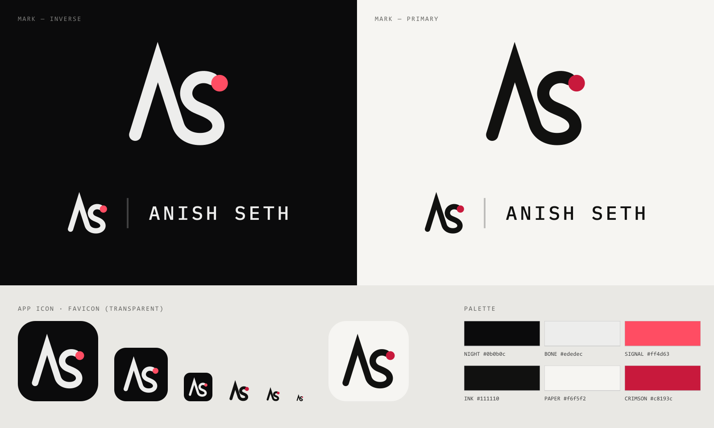

# Anish Seth — Brand Kit

**The mark: “Trace.”** One continuous stroke draws the **A** and flows into the **S**, ending in a crimson **node**: a signal reaching its destination, which suits an engineer who builds agentic systems. The A’s sharp, crossbar-less apex also reads as **λ** (lambda).



## Files

Everything lives in [`/public/brand`](../../public/brand). It's served at `https://anishseth.xyz/brand/<file>`, so other apps can link to it directly.

| Use | File |
| --- | --- |
| Mark on light backgrounds | `mark.svg` · `mark-1024.png` |
| Mark on dark backgrounds | `mark-inverse.svg` · `mark-inverse-1024.png` |
| One-colour (print, stamps, overlays) | `mark-mono-black.svg` · `mark-mono-white.svg` |
| Mark + name, horizontal | `lockup.svg` · `lockup-2400.png` |
| Mark + name on dark | `lockup-inverse.svg` · `lockup-inverse-2400.png` |
| App icon (dark tile) | `icon.svg` · `icon-{64,128,192,256,512,1024}.png` |
| App icon (light) | `icon-light.svg` · `icon-light-{512,1024}.png` |
| Favicon: bare mark, transparent | `favicon.svg` (switches ink/bone with the browser theme) · `favicon.ico` (16/32/48) · `favicon-{16,32,48}.png` |
| iOS home screen | `apple-touch-icon.png` (180, full-bleed) |
| Android / PWA maskable | `icon-maskable-512.png` (mark inside the 80% safe zone) |

The favicon has no background. The SVG version uses `prefers-color-scheme`, so the stroke is ink on light browser tabs and bone on dark ones. The ICO/PNG fallbacks use ink. Favicons use a heavier optical weight (stroke 8.4 instead of 6.6 on the 64-unit grid) so the mark stays crisp at 16 px. Home-screen icons (iOS, Android) keep the Night tile because those platforms fill transparency with black.

### Drop-in snippets

```html
<link rel="icon" href="https://anishseth.xyz/brand/favicon.ico" sizes="any" />
<link rel="icon" href="https://anishseth.xyz/brand/favicon.svg" type="image/svg+xml" />
<link rel="apple-touch-icon" href="https://anishseth.xyz/brand/apple-touch-icon.png" />
```

In React, the inline, theme-aware version is `LogoMark` in `src/components/site/Logo.tsx`. Its stroke follows `currentColor` and the node uses `var(--accent)`.

## Colour

| Name | Hex | Role |
| --- | --- | --- |
| Night | `#0b0b0c` | Dark surface, app-icon tile |
| Bone | `#ededec` | Mark and text on dark |
| Signal | `#ff4d63` | Node on dark |
| Ink | `#111110` | Mark and text on light |
| Paper | `#f6f5f2` | Light surface |
| Crimson | `#c8193c` | Node on light |

The node is the only accent. Never colour the stroke itself.

## Type

The lockup is **mark · hairline · ANISH SETH**. The name is set in **IBM Plex Mono Medium**, all caps, letter-spaced at +0.14em, with a 25%-opacity hairline between it and the mark. The mark's single curving stroke and the precise monospace capitals are meant to contrast, not compete. Proportions at UI size: mark 24 px tall, 12 px gaps, hairline 18 px, name 11.5 px.

In the exported lockups the name is converted to outlines, so no font installation is needed. Display headlines elsewhere use **Archivo**, but never next to the mark.

## Rules

- **Clear space:** keep at least one node diameter of empty space on every side.
- **Minimum size:** 16 px for the favicon, 20 px tall for the bare mark in UI, 120 px wide for the lockup.
- **Don’t:**
  - Rotate, outline or add effects or gradients.
  - Recolour the node to anything but Signal or Crimson (mono versions excepted).
  - Separate the node from the stroke.
  - Set the name next to the mark in any other typeface or style.

## Regenerating

Every asset is generated from one geometry definition by [`generate.cjs`](./generate.cjs). It uses `sharp`, plus `opentype.js` and the bundled IBM Plex Mono font to outline the name. From the repo root:

```bash
npm i --no-save opentype.js
node design/brand/generate.cjs .
```

If the mark changes, update `TRACE` in both `generate.cjs` and `src/components/site/Logo.tsx`, then regenerate so every size stays identical.
